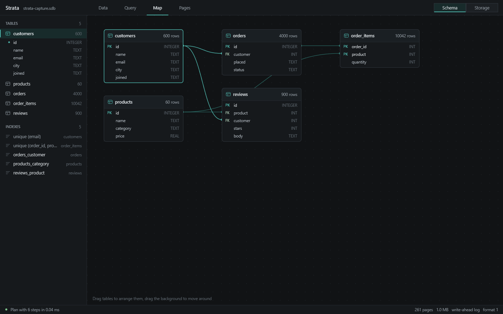
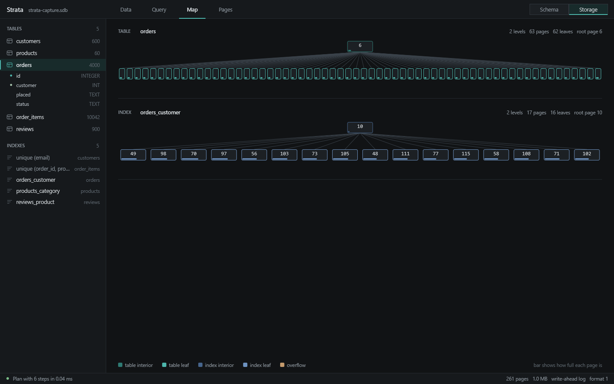
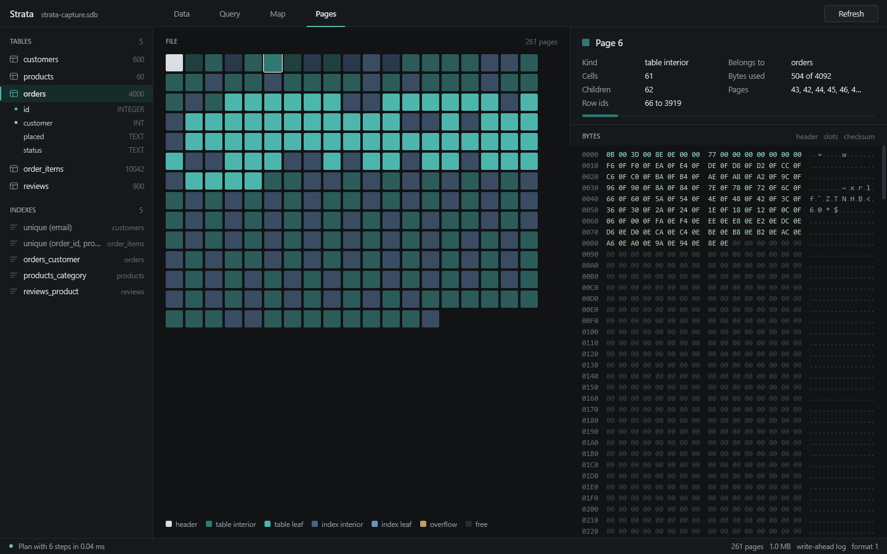

# Strata

Strata is a single-file SQL database engine and a studio app for working with it. It's written from scratch for Windows, with no CRT and no outside code.


## What it does

- **Storage:**
  - one file with 4 KB checksummed pages
  - B-trees with overflow chains
  - a write-ahead log that recovers from crashes at any write
  - statement-level undo inside transactions
- **SQL:**
  - SELECT with joins (inner, left, cross, USING), subqueries (scalar, IN, EXISTS, correlated, in FROM), GROUP BY and HAVING, DISTINCT, ORDER BY and LIMIT
  - UNION, INTERSECT and EXCEPT, plus VALUES
  - INSERT, UPDATE and DELETE, with OR REPLACE, OR IGNORE and ON CONFLICT DO UPDATE
  - CREATE and DROP for tables and indexes, CREATE TABLE AS, and ALTER TABLE ADD COLUMN, RENAME TO and RENAME COLUMN
  - BEGIN, COMMIT and ROLLBACK
- **Constraints:** NOT NULL, UNIQUE, PRIMARY KEY, CHECK, DEFAULT, and foreign keys with RESTRICT, CASCADE and SET NULL.
- **Planner:**
  - row id lookups and ranges
  - index seeks on prefixes and ranges
  - join lookups through indexes
  - EXPLAIN QUERY PLAN
- **Functions:**
  - text: length, substr, trim, replace, instr, upper, lower, printf, quote, hex
  - numbers: round, abs
  - nulls and branching: coalesce, ifnull, nullif, iif
  - aggregates: count, sum, total, avg, min, max, group_concat

## Strata Studio

`strata-studio.exe` opens a database in a window. You can also drop a file onto the window. With no file given, it makes a sample database in `Documents\Strata`.

| | |
|---|---|
|  |  |
|  |  |

- **Data** browses a table, next to an inspector with its rows, storage, columns, indexes and references.
- **Query** has a SQL editor with highlighting and undo. Run with Ctrl+Enter or F5. Results show in a grid, and Explain draws the plan.
- **Map** has two views. Schema draws the tables and their foreign keys; you can drag the tables around. Storage draws each B-tree of a table, level by level, with a bar showing how full each page is.
- **Pages** shows every page of the file as a grid of cells. Picking a page shows its details and a hex dump.



## Command line

```
strata <file>                open a database in the SQL shell
strata <file> "<sql>"        run SQL and print the rows
strata --studio [file]       open the studio
strata --capture <folder>    render every studio view to PNG
strata --test [part]         run the self test (pager, btree, crash, parser, engine)
```

## Building

Open `strata.sln` in Visual Studio 2022 with the Clang toolset, or run MSBuild:

```
msbuild strata.sln /p:Configuration=Release /p:Platform=x64
```

The build writes `build\release\strata.exe` and `build\release\strata-studio.exe`.
