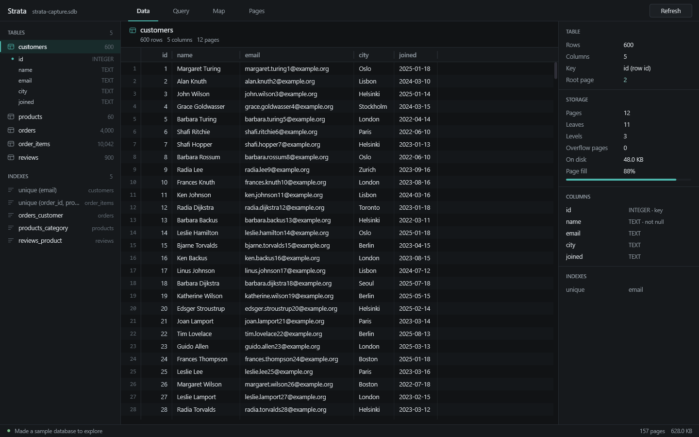
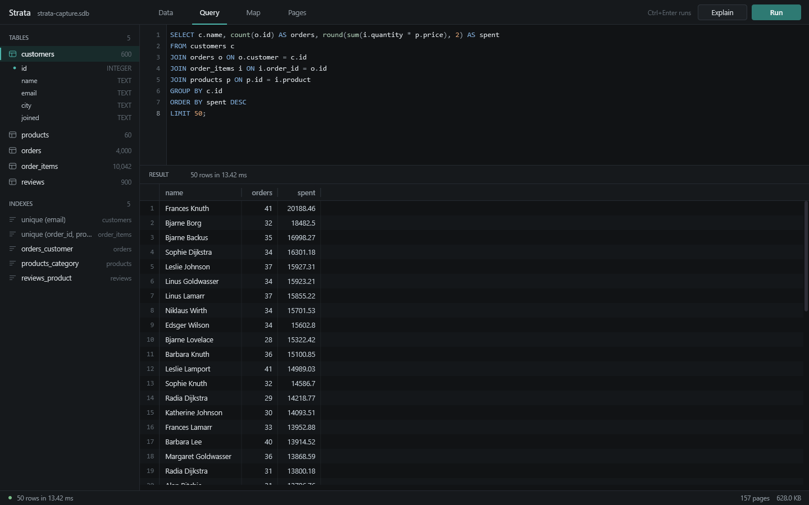
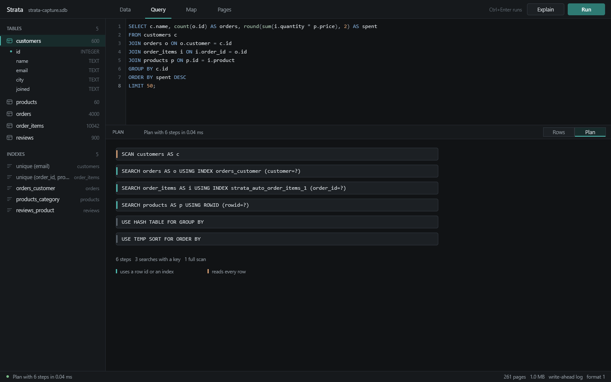
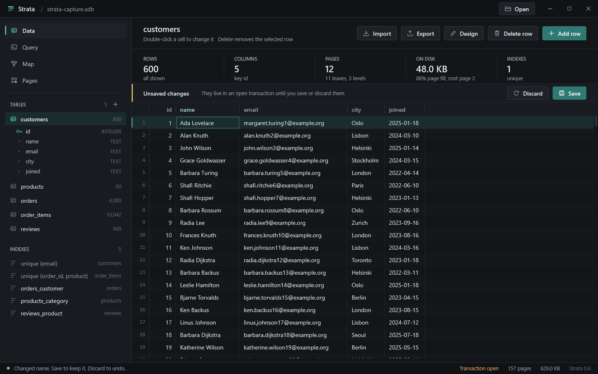
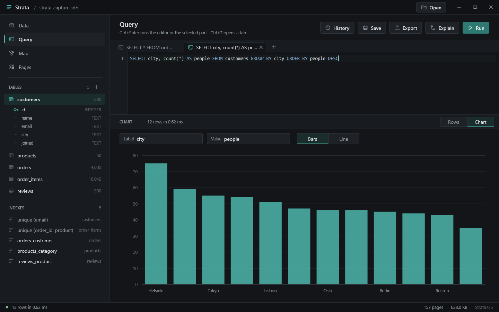
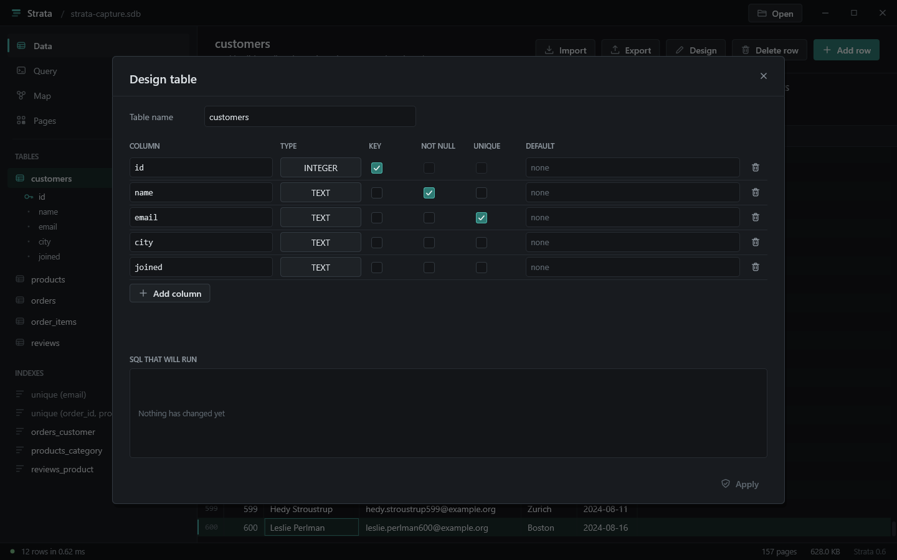
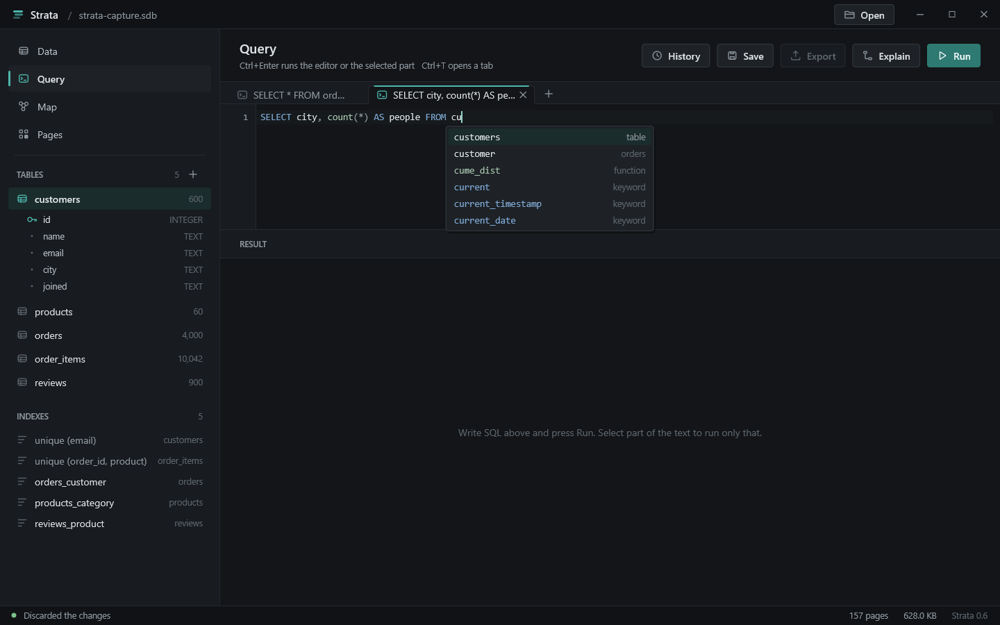

# Strata

Strata is a single-file SQL database engine and a studio app for working with it. It's written from scratch for Windows, with no CRT and no outside code.



## What it does

- **Storage:**
  - one file with 4 KB checksummed pages
  - B-trees with overflow chains
  - a write-ahead log that recovers from crashes at any write
  - statement undo and nested savepoints inside transactions
  - VACUUM, which rewrites the file compactly, and VACUUM INTO for a copy
  - an integrity check that walks every tree, follows the free list and matches every index entry to its row
- **SQL:**
  - SELECT with inner, left, right, full, cross and natural joins, USING, subqueries (scalar, IN, EXISTS, correlated, in FROM), GROUP BY and HAVING, DISTINCT, ORDER BY and LIMIT
  - WITH and WITH RECURSIVE, also in front of INSERT
  - window functions with PARTITION BY, ORDER BY and ROWS or RANGE frames
  - UNION, INTERSECT and EXCEPT, plus VALUES
  - INSERT, UPDATE and DELETE, with OR REPLACE, OR IGNORE and ON CONFLICT DO UPDATE
  - CREATE and DROP for tables and indexes, CREATE TABLE AS, and ALTER TABLE ADD COLUMN, DROP COLUMN, RENAME TO and RENAME COLUMN
  - BEGIN, COMMIT, ROLLBACK, SAVEPOINT, RELEASE and ROLLBACK TO
  - COLLATE NOCASE on columns and expressions
- **Constraints:** NOT NULL, UNIQUE, PRIMARY KEY, CHECK, DEFAULT, generated columns, and foreign keys with RESTRICT, CASCADE and SET NULL.
- **Full-text search:** `CREATE FULLTEXT INDEX` on any text columns, `MATCH` with AND, OR, NOT, prefixes and phrases, ranked with `bm25()`, and `highlight()` and `snippet()` to show where the words were found.
- **Planner:**
  - row id lookups and ranges
  - index seeks on prefixes and ranges, and covering indexes that skip the table
  - ORDER BY straight from an index
  - ANALYZE statistics and a cost-based join order
  - EXPLAIN QUERY PLAN
- **Functions:**
  - text: length, substr, trim, replace, instr, upper, lower, printf with %e and %g, quote, hex
  - numbers: round, abs, sign
  - nulls and branching: coalesce, ifnull, nullif, iif
  - dates: date, time, datetime, julianday, unixepoch and strftime, with modifiers
  - JSON: json, json_extract, json_object, json_array, `->` and `->>`, and JSON aggregates
  - aggregates: count, sum, total, avg, min, max, group_concat
  - windows: row_number, rank, dense_rank, percent_rank, cume_dist, ntile, lag, lead, first_value, last_value and nth_value

## Postgres server

`strata --serve <file>` speaks the Postgres wire protocol, so Npgsql, Dapper, Entity Framework Core, psql and other Postgres clients connect to it like a normal Postgres 17 server.

- **Sign-in:** SCRAM-SHA-256 users kept in `<file>.users`, managed with `strata --user`.
- **Protocol:** simple and extended query, binary and text formats, pipelining and batches, Postgres error codes, and Postgres's transaction states: an error inside a transaction aborts the rest of it until ROLLBACK.
- **Postgres SQL:**
  - schemas and `search_path`
  - IDENTITY and serial columns, which never reuse an id
  - `RETURNING`, `::` casts, typed literals (`TIMESTAMPTZ '...'`), `AT TIME ZONE` and `EXTRACT`
  - `ILIKE`, `= ANY (array)` and `<> ALL (array)`
  - UPDATE and DELETE aliases, `DO` blocks with `IF [NOT] EXISTS`
  - `pg_catalog` and `information_schema` views
- **Exact money:** `NUMERIC(p,s)`, `DECIMAL` and `MONEY` columns store exact decimals up to 36 digits. They round to the declared scale and use Postgres's rules for division and averages.
- **Timestamps and JSON:** timestamps are stored in one canonical UTC form, and `jsonb` is normalized the way Postgres stores it.
- **Concurrency:** many readers run alongside one writer. Each statement sees the latest commits (read committed). Waiting writers drop their snapshot and are served in order, and the next one starts the moment a transaction ends.
- **Realtime:** `LISTEN`, `UNLISTEN` and `NOTIFY` deliver events between connections. Notifications sent inside a transaction arrive only if it commits.

`bindings/csharp/Compat` runs the same Npgsql, Dapper and EF Core scenarios against Strata and a real Postgres and compares every result. `bindings/csharp/Wire` is a dependency-free check with an orders-and-fills trading workload.

## Strata Studio

`strata-studio.exe` opens a database in a window. Open files with Ctrl+O or drop them onto the window. With no file given, it makes a sample database in `Documents\Strata`.

| | |
|---|---|
|  |  |
|  |  |
|  |  |
|  |  |

- **Data** shows a table with its row count, pages and indexes above the rows.
  - Double-click a cell to change it.
  - Add and delete rows from the header.
  - Changes wait in a transaction until you Save or Discard them.
  - Import CSV or JSON from a file or the clipboard into a new table, with the column types worked out for you.
  - Export to CSV or JSON.
  - Design shows the columns and writes the CREATE or ALTER statements for your changes.
- **Query** has tabs of SQL editors with highlighting, undo, and suggestions for tables, columns, functions and keywords.
  - Run with Ctrl+Enter or F5.
  - Results show as rows, as a bar or line chart, or as the plan from Explain.
  - Every query you run goes into History, and you can save queries by name.
- **Map** has two views:
  - Schema draws the tables and their foreign keys, and you can drag the tables around.
  - Storage draws each B-tree of a table, level by level, with a bar showing how full each page is.
- **Pages** shows every page of the file as a grid of cells. Picking a page shows its details and a hex dump, and Check file runs the integrity check and marks any bad pages.


## Command line

```
strata <file>                open a database in the SQL shell
strata <file> "<sql>"        run SQL and print the rows
strata --studio [file]       open the studio
strata --serve <file> [--port 5432] [--host 0.0.0.0]
                             serve the database to Postgres clients
strata --user <file> <name> [password]
                             add or change a server user, or remove it with no password
strata --capture <folder>    render every studio view to PNG and play a scripted session
strata --test [part]         run the self test (pager, btree, crash, parser, engine)
strata --check <file>        check every page, tree, row and index entry; exits 0 when the file is clean
```

## Building

Open `strata.sln` in Visual Studio 2022 with the Clang toolset, or run MSBuild:

```
msbuild strata.sln /p:Configuration=Release /p:Platform=x64
```

The build writes `build\release\strata.exe` and `build\release\strata-studio.exe`.